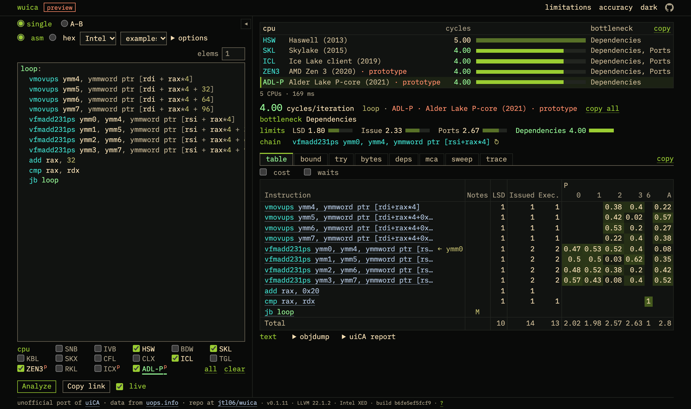

# wuica

[](https://github.com/jtl06/wuica/actions/workflows/ci.yml)
[](https://www.npmjs.com/package/wuica-cli)

Predicts how fast an x86-64 loop runs on a given CPU: cycles per iteration, what limits it, and where every uop goes. In the
browser, on the command line, or from a coding agent.

Paste a hot loop as assembly, as compiler output (`gcc -S`, `objdump -d`, `perf annotate`) or as machine code, and pick the
CPUs. wuica simulates the pipeline cycle by cycle, front end included, fast enough to update as you type. Everything runs on
your machine: the web page sends nothing to a server.

[](https://wuica.jacen.li)

The simulator is an independent Rust/WebAssembly port of [uiCA](https://github.com/andreas-abel/uiCA) (Abel and Reineke), with
three more CPU models. See [Relation to uiCA](#relation-to-uica).

## Use it

- **In the browser:** [wuica.jacen.li](https://wuica.jacen.li).
- **On the command line:** `npx wuica-cli loop.s -arch SKL,ZEN3,ADL-P` (Node 20 or later, no dependencies, offline).

      clang -O3 -march=haswell -S dot.c -o dot.s
      npx wuica-cli dot.s -arch SKL,ZEN3            # the loop it picked, one row per CPU
      npx wuica-cli diff dot.s dot4.s               # before and after
      objdump -d dot.o | npx wuica-cli              # objdump output; perf annotate --stdio works the same way

  The package [`wuica-cli`](https://www.npmjs.com/package/wuica-cli) is also a Node library. Everything it can do is in
  [packages/wuica/README.md](packages/wuica/README.md).
- **From a coding agent:** a local MCP server, `claude mcp add wuica -- npx -y wuica-cli mcp` (the same command works in other
  clients). Tools: analyze, what-if, diff of two versions, compare CPUs, list loops, assemble.
- **Over HTTP:** [api.wuica.jacen.li](https://api.wuica.jacen.li), for scripts and agents without Node; an MCP endpoint is at
  `https://api.wuica.jacen.li/mcp`. Unlike the page and the package, this sends your code to a server.

      curl -s -X POST https://api.wuica.jacen.li/api/analyze/SKL -d '{"hex":"4801d84801c349ffcf75f5"}'

## What you get

- **Cycles per iteration on up to 15 CPUs side by side**, with the bottleneck of each (front end, ports, or a loop-carried
  dependency chain) and how far the other limits are.
- **A table per instruction:** uops, the ports they run on, fusion, and the critical dependency chain.
- **A cycle-by-cycle trace** of every uop through the pipeline, and a dependency view.
- **A–B:** two versions of a loop next to each other, with what changed per instruction and per port.
- **What-if:** the same loop unrolled, with more accumulators, or with parts of the model switched off, to see what a change
  would buy before writing it. An alignment sweep shows the loop at each of the 64 offsets in a cache line.
- **llvm-mca next to it**, on the same code.
- **Input as it comes:** Intel or AT&T assembly, whole `-S` files (it finds the loops and lets you pick), `objdump -d`,
  `perf annotate`, object files (command line), hex, or a Compiler Explorer link.
- **Links:** the page keeps its whole state in the URL, so "Copy link" gives a link to exactly what you see. Results copy as
  Markdown for an issue or a review.

## A worked example

A random-number generator (xoshiro256++) filling an array, its state in a struct passed by pointer:

```c
void fill(rng *r, uint64_t *out, long n) {
    for (long i = 0; i < n; i++)
        out[i] = next(r);            // reads and updates r->s[0..3]
}
```

`out` could point into `r->s`, so gcc reloads the four state words in every iteration and stores them back: 25 instructions,
4 loads, 5 stores. wuica predicts 9.04 cycles per number on Ice Lake server and 4.00 on the other two CPUs: on the Xeon each
reload waits for the store of the iteration before. The fix is one word, `uint64_t *restrict out`, which keeps the state in
registers. Cycles per number, before → after:

| CPU | wuica | measured | llvm-mca 22 |
|---|---|---|---|
| `ICX`, Xeon Gold 6314U | 9.04 → 3.63 | 8.91 → 3.78 | 4.18 → 3.50 |
| `ADL-P`, Core i7-12650H | 4.00 → 3.32 | 4.04 → 3.26 | 4.69 → 4.01 |
| `ZEN3`, Ryzen 7 7735U | 4.00 → 3.49 | 4.54 → 4.01 | 5.01 → 2.76 |

So the change is worth 2.4 times on the Xeon and 13 to 24 % elsewhere, and wuica says so before it is made. It is not exact:
it is 12 % low on the Ryzen, and its report names no bottleneck for the slow loop, only the number. [Open the comparison on
the page](https://wuica.jacen.li/#v=1&m=asm&s=att&a=ICX&as=ICX,ADL-P,ZEN3&c=LkwzOgoJbW92cQkoJXJkaSksICVyY3gKCW1vdnEJOCglcmRpKSwgJXJkeAoJYWRkcQkkOCwgJXI4Cgltb3ZxCTE2KCVyZGkpLCAlcjkKCW1vdnEJMjQoJXJkaSksICVyYXgKCW1vdnEJJXJkeCwgJXIxMAoJeG9ycQklcmN4LCAlcjkKCW1vdnEJJXJheCwgJXJzaQoJYWRkcQklcmN4LCAlcmF4Cgl4b3JxCSVyOSwgJXIxMAoJeG9ycQklcmR4LCAlcnNpCglyb2xxCSQyMywgJXJheAoJbW92cQklcjEwLCA4KCVyZGkpCglzYWxxCSQxNywgJXJkeAoJbW92cQklcmN4LCAlcjEwCglhZGRxCSVyY3gsICVyYXgKCXhvcnEJJXJzaSwgJXIxMAoJeG9ycQklcjksICVyZHgKCXJvcnEJJDE5LCAlcnNpCgltb3ZxCSVyMTAsICglcmRpKQoJbW92cQklcmR4LCAxNiglcmRpKQoJbW92cQklcnNpLCAyNCglcmRpKQoJbW92cQklcmF4LCAtOCglcjgpCgljbXBxCSVyOCwgJXIxMQoJam5lCS5MMwo&ab=1&bm=asm&bs=att&bc=Lkw4OgoJbGVhcQkoJXJheCwlcmRpKSwgJXJkeAoJbW92cQklcjgsICVyOQoJeG9ycQklcmRpLCAlcmN4Cgl4b3JxCSVyOCwgJXJheAoJcm9scQkkMjMsICVyZHgKCXNhbHEJJDE3LCAlcjkKCWFkZHEJJDgsICVyc2kKCXhvcnEJJXJjeCwgJXI4CglhZGRxCSVyZGksICVyZHgKCXhvcnEJJXI5LCAlcmN4Cgl4b3JxCSVyYXgsICVyZGkKCXJvcnEJJDE5LCAlcmF4Cgltb3ZxCSVyZHgsIC04KCVyc2kpCgljbXBxCSVyc2ksICVyMTEKCWpuZQkuTDgK), or see [the sources, the method and a second case](docs/worked-example/README.md).

## CPU models and accuracy

| Models | From | Checked against hardware |
|---|---|---|
| Intel Sandy Bridge to Rocket Lake (12 models) | uiCA | by the uiCA authors (see their paper); not re-measured here |
| AMD Zen 3 (`ZEN3`), Ice Lake server (`ICX`), Alder Lake P-core (`ADL-P`) | the fork [jtl06/uiCA](https://github.com/jtl06/uiCA), marked `prototype` | on one machine each, below |

The three prototype models are tested on a benchmark of 1,844 hot loops from 175 open-source libraries, each measured with
performance counters. The libraries are split in two, one part to develop on and one held out. Share of held-out loops
predicted within 10 % of the measurement, averaged per library:

| Model | Measured on | Loops | wuica | llvm-mca 22 |
|---|---|---:|---:|---:|
| `ADL-P` | Core i7-12650H, P-core | 500 | 83 % | 41 % (`alderlake`) |
| `ICX` | Xeon Gold 6314U | 579 | 77 % | 54 % (`icelake-server`) |
| `ZEN3` | Ryzen 7 7735U, a Zen 3+ laptop chip | 558 | 64 % | 45 % (`znver3`) |

Read this as: an estimate to reason with, not a measurement. A prediction says where the limit is and whether a change should
help; check what matters with `perf`. The model assumes data in the L1 cache and perfectly predicted branches. The Zen 3 model
has only been checked on a Zen 3+ laptop chip. Method, the development numbers and known errors: [docs/ACCURACY.md](docs/ACCURACY.md).

## Measure your own CPU

[wuica-calibrate](https://github.com/jtl06/wuica-calibrate) (pre-release) runs about 1,800 of those loops and a set of pipeline probes on a
Linux x86-64 machine in under ten minutes, without root, and prints a report about that CPU: which model fits it best, where
predictions miss, and what the probes say about its pipeline. The result file it writes is what a model for a new CPU is built
from. Runs on Zen 4, Zen 5, desktop Zen 3 and recent Intel cores are the ones that would help most.

## Relation to uiCA

uiCA is by Andreas Abel and Jan Reineke: *uiCA: Accurate Throughput Prediction of Basic Blocks on Recent Intel
Microarchitectures*, ICS 2022. Its official web version is [uiCA.uops.info](https://uiCA.uops.info). wuica is a separate project
and not affiliated with it.

- **The port is exact.** wuica reproduces the complete report of the Python uiCA (the fork's) on all 18,791 cases of the port's
  test corpus, natively and as WebAssembly, and is about 40 times faster (1 ms per analysis against 40–55 ms). How that is checked:
  [docs/VERIFICATION.md](docs/VERIFICATION.md).
- **The Intel models are uiCA's.** The `ZEN3`, `ICX` and `ADL-P` models are prototypes of the fork
  [jtl06/uiCA](https://github.com/jtl06/uiCA) and are not part of that work.
- **The instruction data** (latencies, throughputs, port usage) comes from [uops.info](https://www.uops.info).

## Building and contributing

    scripts/check.sh            # builds what changed and runs the quick tests (about a minute)
    scripts/check.sh full       # every suite: Rust, WebAssembly, web page, npm package

Start with [docs/VERIFICATION.md](docs/VERIFICATION.md) (the parts, the build commands, how exactness is checked) and
[docs/PORTING.md](docs/PORTING.md) (working in the repository). [docs/DESIGN.md](docs/DESIGN.md) has the structure and the rules
of the port, [docs/SPEC.md](docs/SPEC.md) the measurements, rejected ideas and known weaknesses. A prediction that disagrees
with a measurement is the most useful kind of [issue](https://github.com/jtl06/wuica/issues): include the loop, the CPU and
both numbers.

## Licenses

- wuica is a derivative work of uiCA and is licensed under the **GNU AGPL v3** (`LICENSE`), like uiCA. The license covers wuica
  itself; the code you analyze with it stays under whatever license it has.
- `third_party/xed` is a subset of [Intel XED](https://github.com/intelxed/xed) (Apache License 2.0, `third_party/xed/LICENSE`).
- The assembler is a modified build of [LLVM](https://llvm.org) 22.1.2 (Apache License 2.0 with LLVM Exceptions,
  `assembler/LICENSE-LLVM.txt`; the changes are in `assembler/llvm-22.1.2-wasi.patch`).
- The web page uses IBM Plex Mono (SIL Open Font License 1.1, `web/fonts/OFL.txt`).
- The instruction data (latencies, throughputs and port usage) comes from [uops.info](https://www.uops.info) by Andreas Abel and
  Jan Reineke. It is not part of this repository: the tables are generated locally from a uiCA installation with
  `tools/export_data.py`.
